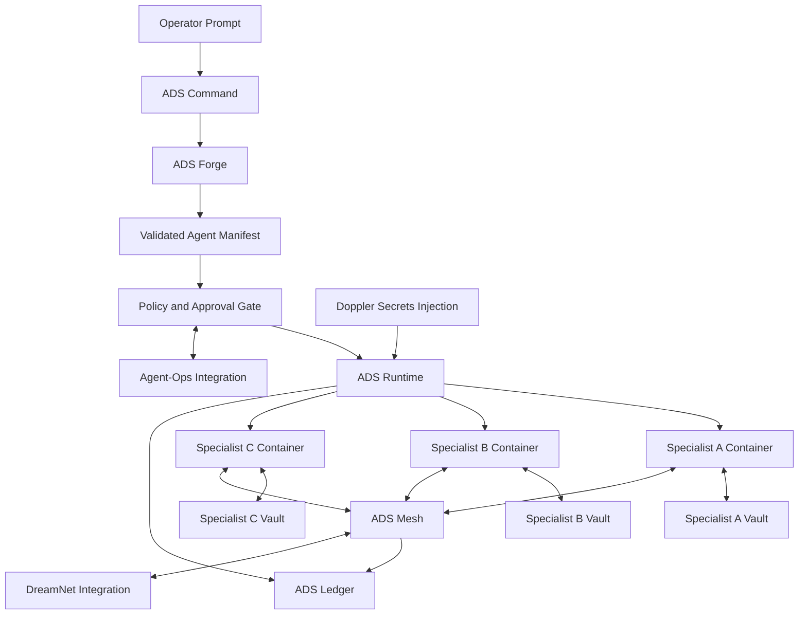

# Agents-Direct-Swarms (ADS)
Your persistent, verifiable, and contained AI workforce management platform and specialist identity forge. Provision, bootstrap, deploy, and orchestrate independent AI agents through natural-language prompts.

### (ADS) - AI Workforce 

Your persistent, verifiable, and contained AI workforce management platform and specialist identity forge.

Forge identities. Deploy specialists. Orchestrate intelligence.

Status License Runtime Secrets

A **PyroFire Labs** initiative.

> **Development status:** ADS is an early-stage project. This README defines the proposed architecture and roadmap. Commands, interfaces and integrations below are design targets, not claims of currently available functionality.

*Vision*

AI specialists should be more than disposable chat sessions. They should have durable identities, dedicated workspaces, explicit responsibilities, controlled access to tools, and verifiable operational histories.

Agents-Direct-Swarms aims to turn natural-language instructions into independently provisioned, bootstrapped and managed AI specialists. Each specialist operates within an isolated runtime, retains authorized state across restarts, and can collaborate with other specialists without surrendering its individual identity.

One prompt → one validated manifest → one independently running specialist → one durable workspace.

Foundational pillars


|Pillar                   |Purpose                                                                       |
|-------------------------|------------------------------------------------------------------------------|
|Persistence              |Durable identities, workspaces, memory and operational state.                 |
|Verifiability            |Inspectable manifests, execution records, provenance and audit trails.        |
|Containment              |Independent runtimes with scoped permissions, resources and network access.   |
|Specialist identity forge|Prompt-driven creation of role-specific agents with explicit responsibilities.|
|Workforce management     |Lifecycle control, organizational structure, delegation and collaboration.    |

## Architecture



The diagram describes the proposed logical architecture
of Agents-Direct-Swarms. Each specialist operates within
an independently provisioned container, maintains isolated
persistent state, and receives scoped credentials through
Doppler secrets injection.

The diagram describes logical components, not a requirement to run six separate services. Vault access must be isolated per specialist; shared infrastructure must not imply shared credentials or unrestricted memory access.

|Component      |Responsibility                                                     |
|---------------|-------------------------------------------------------------------|
|**ADS Forge**  |Compile prompts into validated identity and deployment manifests.  |
|**ADS Runtime**|Provision, bootstrap, supervise and recover independent containers.|
|**ADS Vault**  |Manage durable workspaces, identity records, memory and state.     |
|**ADS Ledger** |Record attributable lifecycle events and operational evidence.     |
|**ADS Mesh**   |Provide authenticated, policy-controlled inter-agent messaging.    |
|**ADS Command**|Expose CLI, API and workforce management dashboard.                |

Specialist provisioning lifecycle

1. Interpret the operator’s prompt into a typed manifest.
2. Resolve a supported runtime adapter and pinned container image.
3. Validate resource limits, permissions, repository access and secret references.
4. Present the deployment plan for approval when required.
5. Allocate a unique specialist ID, dedicated persistent volumes and network policy.
6. Inject scoped credentials through Doppler and bootstrap the runtime.
7. Launch the specialist, run health checks and register its deployment.
8. Record provisioning evidence and expose lifecycle controls.

Provisioning should be idempotent, recoverable after interruption, and fail closed when validation or credential injection fails. Failed deployments must not leave unrestricted credentials or orphaned resources behind.

Proposed developer experience

The following CLI is illustrative and is not yet an installation guide.

ads forge "Create a cybersecurity specialist named David with a dedicated workspace, persistent memory and an isolated Docker runtime."

ads list
ads inspect david
ads verify david
ads attach david
ads logs david
ads stop david
ads resume david
ads backup david

Provision an entire team:

ads swarm "Create a software engineering department with a director, frontend engineer, backend engineer, security specialist and QA engineer."

A swarm request should produce an inspectable plan containing individual specialist manifests, communication permissions and aggregate resource limits before deployment.

Specialist manifest

The proposed ADS manifest is a versioned, runtime-independent contract. It describes desired state without embedding credentials.

apiVersion: ads.pyrofire-labs/v1alpha1
kind: Specialist
metadata:
  name: david
  organization: pyrofire-labs
  department: engineering
spec:
  identity:
    displayName: David
    role: Cybersecurity Specialist
    instructions: ./AGENTS.md
    personality: ./SOUL.md
  runtime:
    adapter: hermes-agent
    imageRef: ads/hermes:development # illustrative; resolve to approved digest
  resources:
    cpu: 1
    memoryMiB: 2048
  workspace:
    persistent: true
    mountPath: /workspace
  memory:
    persistent: true
    backend: sqlite
  secrets:
    provider: doppler
    project: ads-example
    config: david
  communication:
    enabled: false
  access:
    ssh: false
  security:
    privileged: false
    hostDockerSocket: false
    runAsNonRoot: true
    networkPolicy: restricted

The schema, image reference and Doppler project/config names are illustrative. Runtime adapters must declare supported capabilities; persistence of files alone does not guarantee persistence of model context or sessions.

Engineering standards

• TypeScript-first, with typed interfaces and runtime schema validation.
• Docker-first deployment with independently managed specialist containers.
• Doppler is the secrets provider. PyroFire Labs does not use .env files.
• No secrets in manifests, source control, image layers, build arguments or audit logs.
• Versioned manifests, runtime adapters and migration procedures.
• Automated tests for provisioning, isolation, recovery and lifecycle behavior.
• Local-first development with optional remote deployment backends.

Doppler integration

The provisioning service should authenticate using narrowly scoped credentials and resolve only the secrets approved for each specialist. Inject credentials at runtime, preferably through a runtime-supported mechanism that minimizes exposure. Do not give specialists broad Doppler administration credentials. Environment-based injection is not equivalent to using .env files; injected variables still require protection from process inspection and logs.

Containment and trust

Containers are an isolation mechanism, not an absolute security boundary. ADS should enforce non-root execution, capability reduction, resource limits, restricted mounts and controlled network access. Never mount the host Docker socket into an untrusted specialist. Workloads requiring stronger isolation or nested Docker should use an appropriately isolated VM or sandbox backend.

Treat prompts, repository content, tool output and inter-agent messages as untrusted input. Model-generated plans must not override deterministic policy checks. Destructive actions, credential expansion and external side effects should be subject to explicit authorization.

Verifiability

ADS Ledger should associate each event with a specialist ID, deployment ID, manifest digest, timestamp and actor. Record lifecycle transitions, approvals, tool execution metadata and image provenance while redacting secrets and sensitive content. Tamper-evident records and signed attestations are future targets; ordinary logs alone do not establish cryptographic proof or correctness of agent behavior.

Proposed technology stack

|Layer               |Technology                                                   |
|--------------------|-------------------------------------------------------------|
|CLI                 |TypeScript, Commander.js                                     |
|Management API      |Node.js, Fastify                                             |
|Dashboard           |Next.js                                                      |
|Provisioning        |Docker Engine API, Dockerode                                 |
|Prompt compilation  |Vercel AI SDK, Zod                                           |
|Secrets             |Doppler                                                      |
|Local registry      |SQLite                                                       |
|Distributed registry|PostgreSQL (future)                                          |
|Messaging           |NATS (future)                                                |
|Runtime adapters    |Hermes Agent, Claude Code, Codex, Gemini CLI, custom runtimes|
|Integrations        |DreamNet, Agent-Ops, MCP, A2A                                |
|Image distribution  |GitHub Container Registry                                    |

Runtime integrations depend on supported interfaces, authentication requirements and applicable provider terms. MCP is a tool/context integration protocol, not a replacement for inter-agent messaging.

## Proposed Repository Layout

```text
Agents-Direct-Swarms/
├── apps/
│   ├── cli/
│   ├── daemon/
│   └── dashboard/
├── packages/
│   ├── core/
│   ├── manifest/
│   ├── forge/
│   ├── runtime/
│   ├── vault/
│   ├── ledger/
│   ├── mesh/
│   ├── policy/
│   └── sdk/
├── runtimes/
├── backends/
│   ├── docker/
│   └── sandbox/
├── integrations/
│   ├── doppler/
│   ├── dreamnet/
│   └── agent-ops/
├── templates/
├── tests/
├── docs/
├── AGENTS.md
├── README.md
└── LICENSE
```
Development roadmap

☐ Phase 1 — Forge and provision: manifest schema, prompt compiler, deterministic validation, one Docker runtime adapter, Doppler injection and durable workspace.
☐ Phase 2 — Lifecycle: registry, start/stop/resume, logs, health checks, backups and recovery.
☐ Phase 3 — Verification and containment: policy tests, provenance, audit events and isolation validation.
☐ Phase 4 — Runtime expansion: additional framework adapters and capability discovery.
☐ Phase 5 — Workforce orchestration: authenticated messaging, delegation, organizational roles and DreamNet/Agent-Ops integrations.
☐ Phase 6 — Distributed management: dashboard, remote hosts, stronger isolation backends and optional commercial services.

First milestone acceptance criteria

• A valid prompt produces a schema-valid, inspectable manifest.
• An approved manifest launches exactly one independently identifiable container.
• Restarting the container preserves its authorized workspace and identity state.
• Repeating a provisioning request does not create unintended duplicates.
• Invalid permissions and failed secret injection prevent deployment.
• Credentials are absent from generated manifests, images and captured logs.
• Stop and recovery operations do not affect another specialist’s workspace.
• Provisioning and lifecycle events can be inspected and attributed to the specialist.

PyroFire Labs ecosystem

ADS creates and manages the workforce. DreamNet connects the workforce. Agent-Ops governs the workforce.

GundariuM and Xcelsior Tech Services are intended first-party use cases for the infrastructure. Integration boundaries and compatibility will be established through implementation and testing rather than assumed.

Contributing

During early development, contributions should focus on architecture proposals, manifest design, runtime adapters, security review and reproducible tests. Open an issue before undertaking substantial changes. Never include credentials, private agent memory or customer data in contributions.

License

Intended to be licensed under the Apache License, Version 2.0. See the repository’s LICENSE file for the governing terms once added. Third-party runtimes and dependencies retain their respective licenses and terms.

────────

Agents-Direct-Swarms — A PyroFire Labs initiative.
